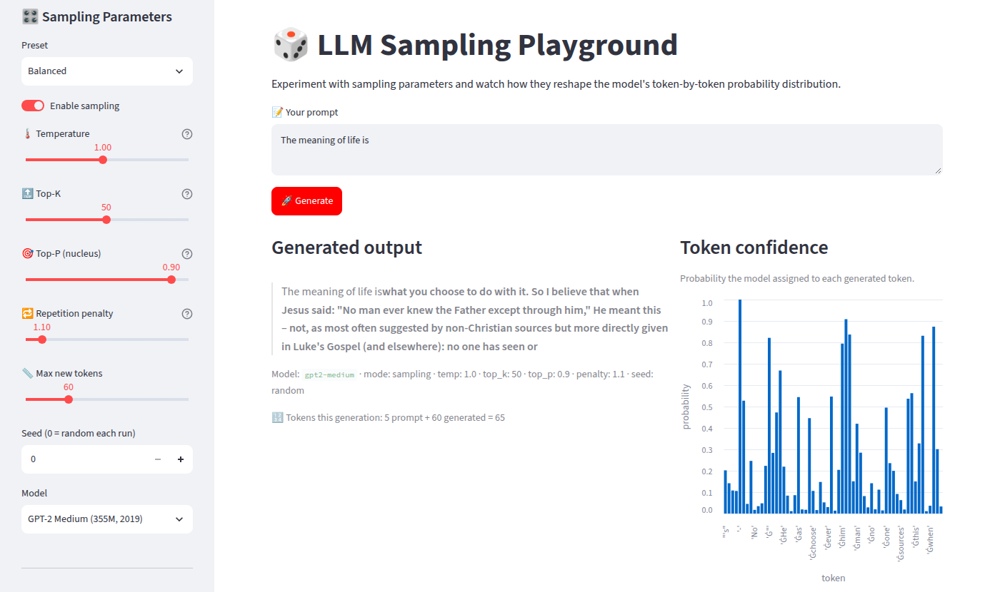

# LLM Sampling Playground 🎲

[](https://github.com/niclashart/LLM-Sampling-Playground/actions/workflows/test.yml)

An interactive playground for understanding how **sampling parameters** shape
the output of autoregressive language models — built with
[Streamlit](https://streamlit.io) and 🤗 Transformers.

Pick a model spanning seven years of open LLMs — from GPT-2 (2019) to
LiquidAI LFM2.5 (2026) — tweak temperature / top-k / top-p / repetition
penalty, generate, and inspect a chart of the probability the model assigned
to **each generated token**. Presets (`Creative`, `Focused`, greedy decoding)
make A/B comparisons a click away.



This is a tool for **exploration, not evaluation**: no benchmarks, no scores —
the goal is to see and feel what sampling does, not to rank models.

## The one experiment to try first

Same prompt, same seed, 2019 vs. 2026 — the active model comparison runs both
side by side so the only difference is the model:

```bash
python cli.py --model gpt2 --seed 42 "The meaning of life is"
python cli.py --model LiquidAI/LFM2.5-350M --seed 42 "The meaning of life is"
```

Or open the app, hit **⚔️ Active model comparison**, and get outputs, token
consumption, and tokens/sec in one table and chart. On my CPU this showed
LFM2.5-350M generating ~23× faster than GPT-2 while using a comparable number
of tokens for the same text.

## Why a token probability chart?

Sampling parameters are usually explained with words alone. This app shows
their *effect*: after generation you see, per token, how confident the model
was. Switch to greedy decoding and watch every token become the argmax;
crank the temperature and watch confidence flatten out.

## Quick start

```bash
python -m venv .venv && source .venv/bin/activate
pip install -r requirements.txt
streamlit run app.py
```

Or use the CLI for headless experiments (any Hugging Face causal-LM id works):

```bash
python cli.py --temperature 1.4 --seed 42 "The future of AI in healthcare is"
python cli.py --model Qwen/Qwen2.5-0.5B --greedy "Once upon a time"
```

## Features

- **Sampling knobs**: temperature, top-k, top-p (nucleus), repetition penalty
- **Greedy mode** to contrast deterministic vs. sampled generation
- **Seed control** for reproducible runs
- **Token confidence chart** after every generation
- **Active model comparison**: same prompt + seed on several models —
  outputs, token consumption, and tokens/sec side by side
- **Tokenizer comparison chart**: how many tokens each model's tokenizer
  needs for the current prompt (no model weights loaded)
- **Model switcher** spanning seven years of small open models, all CPU-friendly:
  GPT-2 family (2019) → SmolLM2 / Qwen2.5 / TinyLlama (2024) → SmolLM3 (2025)
  → LiquidAI LFM2.5-350M & 1.2B (2026)
- **Presets** for quick comparisons
- **Session usage tracking** (tokens per generation + running totals)
- **Generation history** with CSV export

## Project layout

```
generator.py   # UI-free core: params → generate() → text + token probabilities
app.py         # Streamlit UI (thin skin over generator.py)
cli.py         # Headless CLI — same seams as the app
tests/         # Unit tests for the generation logic
.github/       # CI workflow (ruff + pytest)
```

## Testing & CI

```bash
pip install pytest ruff
ruff check .
pytest
```

GitHub Actions ([`.github/workflows/test.yml`](.github/workflows/test.yml))
runs `ruff check` and the test suite on every push to `master` and on every
pull request.

## Ideas welcome, deliberately out of scope

Other tasks (summarization, chat) and benchmark scoring would turn this into
an eval platform — this project intentionally stays a sampling playground.

## License

[MIT](LICENSE)
